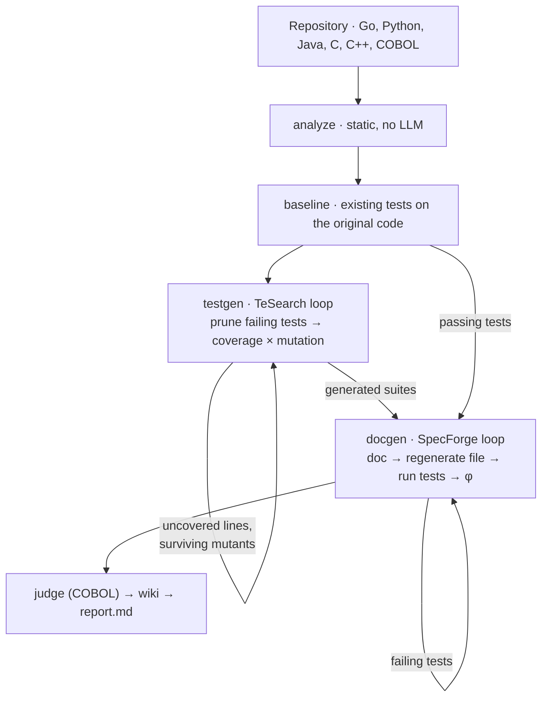

# How it works

CoDoc turns two research methods into a practical, bounded pipeline:

- **SpecForge** ([arXiv 2610.15708](https://arxiv.org/abs/2610.15708), NeurIPS 2026) treats a
  natural-language doc as a behavioural specification and judges it by whether code generated
  from it passes execution-verified tests.
- **TeSearch** ([arXiv 2610.15964](https://arxiv.org/abs/2610.15964), NeurIPS 2026 EvoRobust
  workshop) searches for small but
  strong test suites, judged by coverage and mutation score.

## Pipeline

`codocs run REPO -o OUT` runs these stages in order:

| Stage | LLM | What it does |
|---|---|---|
| analyze | no | detects languages, units and target files; builds the COBOL index |
| baseline | no | runs the existing tests on the original code and records which pass |
| testgen | yes | TeSearch loop per target file |
| docgen | yes | SpecForge loop per target file |
| judge | yes | COBOL doc judge (only when COBOL is selected and either this run wrote COBOL docs or `--source-lang` names `cobol`) |
| wiki | yes | repository wiki from the delivered docs |
| report | no | `report.md` and `summary.json` |



`testgen` runs before `docgen` so that its delivered suites can score the docs of files that have
no relevant existing tests. `bizlogic` is a separate command.

## The bounded loop

Both loops share one shape, run independently per target file:

```
best = None
for r in 1..rounds:
    artifact = seed()            if r == 1          # one LLM call
               refine(best)      otherwise          # one LLM call, given the measured failures
    score = evaluate(artifact)                      # build and run, no LLM
    best = the better of best and artifact
    if score >= threshold: stop                     # early stop
deliver best
```

A file whose status is already `ok` is skipped on a re-run (unless `--force`), and every LLM
reply is cached, so loops resume after an interruption.

## Docs: the SpecForge loop

| | |
|---|---|
| Artifact | a Markdown doc of the target file (RepoAgent-style `ClassDef` / `MethodDef` sections) |
| Evaluate | a separate LLM call regenerates the target from the doc; the regenerated file replaces the original in a sandbox copy of the package and the relevant tests are run |
| Score | φ = passed relevant tests / relevant tests; 0 if the regenerated code does not build |
| Defaults | `--doc-rounds 3`, `--doc-threshold 0.9` |

Details:

- **No peeking.** The regeneration prompt has the doc, the signatures and declarations of the
  *other* files in the package, and the imports the file may use. It never contains the original
  source, so a passing test means the doc carried the behaviour.
- **Relevant tests** are the existing tests that pass on the original code and exercise the
  target. Without them the loop uses CoDoc's own delivered suite for the file, then a compile
  check (COBOL: the static facts signal, which spec programs always use;
  [COBOL](cobol.md#facts-signal)).
- **Import repair.** Up to two automatic import fixes are applied to regenerated code before it
  counts as a build failure.
- **Refinement.** The refine call sees the source, the current doc, the regenerated code and the
  failing tests with their messages. It diagnoses which part of the doc misled the regeneration
  and prescribes the fix, in one call.
- Regeneration runs at temperature 0. The doc and regeneration token budgets scale with the
  file size (up to 64,000).
- Each round's doc, regenerated code and evaluation are kept under `OUT/docgen/`; the best doc
  goes to `OUT/docs/<pkg>/markdown_docs/`.

## Tests: the TeSearch loop

| | |
|---|---|
| Artifact | one self-contained test suite per target file |
| Evaluate | the suite runs in the sandbox with the package's own tests hidden; failing tests are pruned; coverage and mutation score are measured on the passing subset |
| Score | coverage × mutation score (coverage alone when `--mutants 0` or no mutant is valid) |
| Defaults | `--test-rounds 3`, `--test-threshold 0.85`, `--mutants 20` |

Details:

- **Pruning.** Failing tests are removed and the suite re-run until it is green, at most 8 runs.
- **Mutants** are produced by deterministic, language-specific operators (comparison, logic,
  arithmetic, assignment, booleans; COBOL has its own set), sampled with `--mutant-seed`. A
  mutant on an uncovered line is only compiled; if it builds it counts as survived. Mutant runs
  time out after min(test timeout, max(30 s, 3 × the green suite's time + 10 s)).
- **Gap markers.** The next round's prompt shows the source with uncovered lines and surviving
  mutants marked inline.
- **Delivery.** Rounds are ranked by score, then non-empty suite, then coverage, then the smaller
  suite, then the earlier round: the smallest among the best.

## What is simplified relative to the papers

CoDoc implements **bounded, simplified versions** of both algorithms, sized for running over a
whole repository:

- From SpecForge it keeps the regenerate-without-source signal and diagnosis-plus-prescription
  refinement (merged into one call). It does **not** implement the Pareto archive of states,
  the dependency-ordered entity selection or the error-diversified multi-branch expansion; each
  file is refined on its own in a single chain.
- From TeSearch it keeps the measurement (prune failing tests, coverage and mutation on the
  passing subset), inline gap markers and "smallest among the best" delivery. It does **not**
  implement the quality-diversity search over suite sizes or the learned transition kernel.

The paper results ([README](../README.md#results-from-the-papers)) are for the full algorithms.

## Architecture

| Module (`src/codocs/`) | Role |
|---|---|
| `cli.py` | the `codocs` command |
| `config.py` | settings: defaults, `.env` / environment, CLI; model aliases |
| `llm.py` | cached LLM calls (SQLite cache on top of the RepoWiki OpenAI client) |
| `pipeline.py` | stage orchestration, sandbox mirror, run metadata |
| `baseline.py` | existing tests on the original code |
| `specforge/` | doc loop: prompts, doc format, bounded loop |
| `tesearch/` | test loop: prompts, bounded loop, coverage × mutation measurement |
| `lang/` | language adapters and runners for Go, Python, Java, C/C++, COBOL; detection registry |
| `golang/` | Go toolchain driver, package model, mutation operators |
| `cobol/` | COBOL parser, index, program modes, test harness, facts signal, judge, wiki planner |
| `bizlogic/` | business-logic graph, clustering, walks, inference, diagrams, domain profiles |
| `wiki.py`, `report.py` | wiki stage; `report.md` / `summary.json` |
| `repowiki/` | vendored, modified fork of RepoWiki: planner, generator, Mermaid validation, translator, exporters |
| `prompts/` | system prompts and per-language prompt fragments |

## Limits

- φ measures only the behaviour the tests exercise. A file with weak tests can reach φ = 1 with
  an incomplete doc; that is why CoDoc can score docs against its own generated suites.
- The compile-check fallback says little about a doc's accuracy; the report lists the signal
  each doc was scored with.
- Gradle builds are unsupported; C/C++ test frameworks run only through `--test-cmd`; CICS, DB2,
  IMS and screen COBOL programs are not executed.
- CoDoc executes generated code and the repository's tests on your machine. See
  [SECURITY.md](../SECURITY.md).
