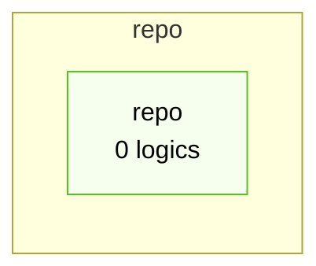
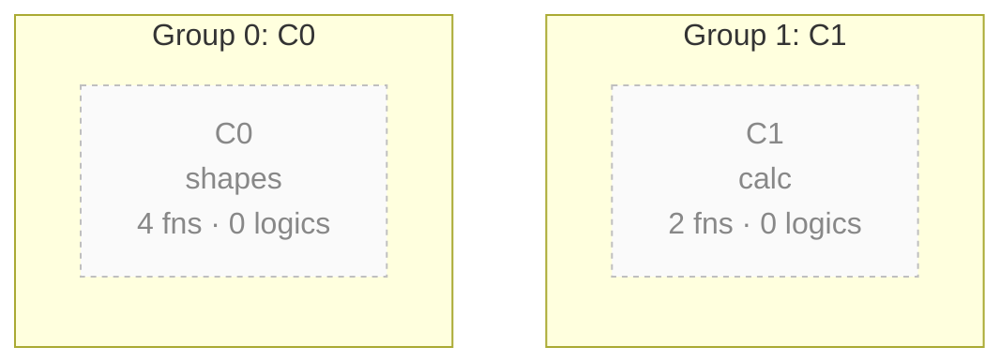

# Business Logic (K = 2)

Business logic inferred from behaviour trajectories: random walks over the function dependency graph from entry roots, deduplicated by their sequence of clusters at this granularity. Fewer clusters give fewer, coarser business logics. Each business logic was inferred by an LLM from code evidence; diagrams are generated from that inference and the code structure, and mark what the code confirms. Read them as a map, not a specification.

## System context

No business logic was inferred, so no outside party is shown.

## Who takes part in which group

No business logic was inferred (plan only), so no outside party is known.

- [G0](bizlogic-k2-p0.md) = Group 0: C0
- [G1](bizlogic-k2-p1.md) = Group 1: C1

## Code components (clustered)

Components were not labelled by the LLM: white = business logic passes through it, dashed grey = none does; dashed border = mixed (packages from more than one deployable). The package line shows what each contains.

| group | component | top packages | functions | kind | business logics |
|---|---|---|---|---|---|
| G0 | [C0](bizlogic-k2-c0.md) | shapes | 4 |  | 0 |
| G1 | [C1](bizlogic-k2-c1.md) | calc | 2 |  | 0 |

## Component call map

No calls observed between components at this granularity.

## All business logic

0 business logics

| # | business logic | category | group | initiated by | parties | walks (whole path) | confidence |
|---|---|---|---|---|---|---|---|

## Coverage by subsystem

Subsystems whose roots were not sampled, or whose code no trajectory passes through, are absent from this page because of sampling, not because the code lacks the behaviour.

| subsystem | business functions | candidate roots | roots walked | functions visited | trajectories |
|---|---|---|---|---|---|
| shapes | 4 | 0 | 0 | 0 | 0 |
| calc | 2 | 0 | 0 | 0 | 0 |

No business logic passes through: shapes, calc.

## Run

| item | value |
|---|---|
| functions (business / utility) | 6 / 0 |
| base communities | 2 |
| clusters K | 2 |
| parent level | 2 |
| entry roots (walked / candidates) | 0 / 0 |
| walks |  |
| business functions visited | 0 / 6 |
| distinct cluster sequences |  |
| min walks per kept sequence | 1 |
| rarer sequences folded in |  |
| after prefix merge |  |
| business logics |  |
